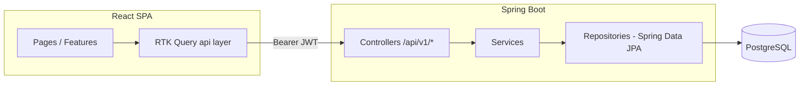
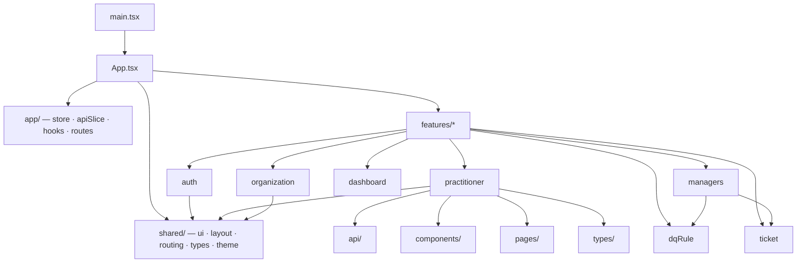
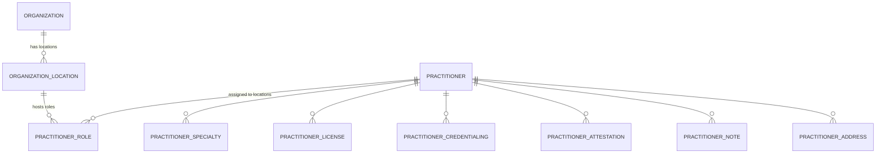
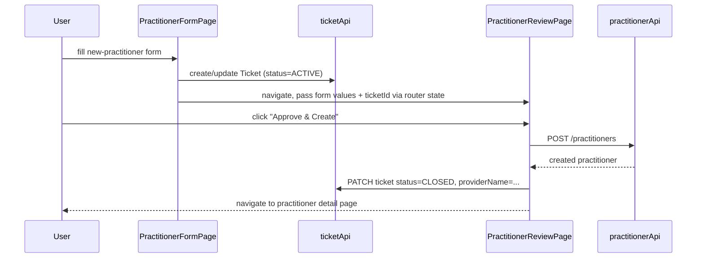
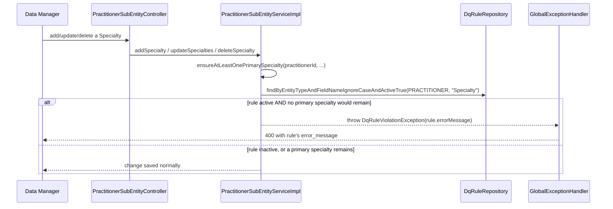
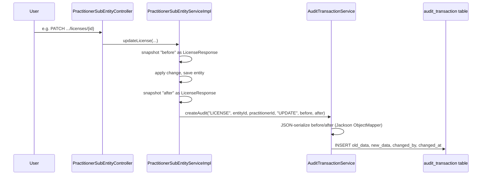

# PDM — Provider Data Management

Web application to manage Provider Data: Practitioners, Organizations, Locations, the
relationships between them, provider intake workflow, data-quality rules, and audit history.

- **Backend**: Spring Boot (Java), PostgreSQL, Flyway migrations, JWT auth
- **Frontend**: React + TypeScript, Redux Toolkit / RTK Query, MUI

This document explains how the four major capabilities work end-to-end — **PDM core domain**,
**Service Manager**, **Reporting Manager (DQ Rules)**, and **Data Manager / Audit Transactions**
— so a new developer can trace a request from screen to database and back, and know where to
make a change.

> ⚠️ Several things below are flagged **NOT ENFORCED** or **PLACEHOLDER**. These aren't bugs in
> this doc — they're the actual current state of the code, called out so nobody assumes protection
> that isn't there.

---

## 1. High-level architecture



Everything is a single REST API (`/api/v1/**`) consumed by one React app. There is no
BFF/gateway layer. Auth is JWT, issued by `/api/v1/auth/login`, verified per-request by a
servlet filter (`JwtAuthFilter`), and attached to every RTK Query request automatically via
`apiSlice.prepareHeaders`.

### Repo layout

```
backend/src/main/java/com/pdm/
  controller/   REST endpoints
  service/      business logic (interface) + service/impl (implementation)
  entity/       JPA entities (tables)
  repository/   Spring Data JPA repositories
  dto/          request/ and response/ DTOs
  mapper/       MapStruct entity <-> DTO mappers
  security/     JWT filter, JwtService, UserDetailsService
  config/       SecurityConfig, JpaAuditingConfig
  exception/    GlobalExceptionHandler, ApiError, custom exceptions
  event/        (empty — placeholder for future Kafka domain events)
backend/src/main/resources/db/migration/   Flyway SQL migrations (V1..V9, source of truth for schema)
```

The frontend is organized **by feature, not by file type** — a file lives next to the
domain it belongs to, and only moves to `shared/` once a second feature needs it:

```
frontend/src/
├── main.tsx                  entry point — mounts <App/> with the Redux <Provider>
├── App.tsx                   shell only: ThemeProvider, NavBar, <AppRoutes/>
│
├── app/                      cross-cutting app wiring (not a feature)
│   ├── store.ts                 Redux store
│   ├── apiSlice.ts               RTK Query base (all feature APIs inject into this)
│   ├── hooks.ts                  typed useAppDispatch / useAppSelector
│   └── routes.tsx                the <Routes> table (pulled out of App.tsx)
│
├── shared/                   reusable across 2+ features
│   ├── ui/                       SectionCard, NavTileCard
│   ├── layout/                   NavBar
│   ├── routing/                  ProtectedRoute, RoleGuard
│   ├── types/                    common.ts (e.g. Page<T>, EntityStatus)
│   └── theme.ts
│
└── features/                 one folder per domain area
    ├── auth/                     authSlice, api/, pages/ (Login), types/
    ├── practitioner/             api/, components/ (cards), pages/, types/, __tests__/
    ├── organization/             api/ (org + org-location), pages/, types/
    ├── dqRule/                   api/, types/
    ├── ticket/                   api/, types/
    ├── dashboard/                Dashboard.tsx, dashboardCards.ts
    └── managers/                 the 3 landing-page workspaces (Provider Data/
                                   Service/Reporting Manager) — nav shells with
                                   no api/types of their own
```



Each feature exposes `api/` (RTK Query endpoints), `pages/` (route components),
`types/` (TS types mirroring backend DTOs) and, if it owns UI that only it uses,
`components/`. A feature may import from `shared/` and `app/`, but not reach into
another feature's internals — cross-feature use (e.g. `managers/` pulling in
`ticket/api` and `dqRule/api`) goes through that feature's `api/`/`types/` surface.

### Landing page → three "manager" workspaces

`Dashboard` (`frontend/src/features/dashboard/Dashboard.tsx`, driven by `frontend/src/features/dashboard/dashboardCards.ts`)
shows three tiles. These are **workflow areas, not backend roles** — clicking a tile just
navigates; nothing in the frontend or backend currently restricts a given tile to a given user:

| Tile | Route | What it actually is |
|---|---|---|
| Provider Data Manager | `/provider-data-manager` | Entry point into core PDM CRUD (Practitioner, Organization) |
| Provider Service Manager | `/provider-service-manager` | Ticket queue — the intake/approval workflow |
| Provider Reporting Manager | `/provider-reporting-manager` | DQ Rules CRUD screen (despite the name, this is where data-quality rules live, not reports) |

There is a **separate** auth-role model (`UserRole`: `PD_ASSOCIATE` / `PD_ADMIN` / `READ_ONLY`,
stored on `AppUser`) that is not wired to these three tiles. See §5.

---

## 2. PDM core domain (Practitioner / Organization / Location / Roles)

### Entity relationships



- **Organization** (`organization` table) — legal entity, e.g. "AIIMS". Unique `npi` (Type-2),
  unique `taxId`. Insurers/payers are deliberately **not** modeled as Organizations (no
  `INSURER` value in `OrganizationType`) — they're consumers of PDM data, not subjects of it.
- **OrganizationLocation** (`organization_location` table) — a physical site under an
  Organization, e.g. "AIIMS Delhi" under "AIIMS". `organization_id` FK is `NOT NULL`.
- **Practitioner** (`practitioner` table) — an individual provider. Unique `npi` (Type-1),
  system-generated `healthPlanId` (`"PRC" + timestamp`). Has 6 child sub-entity tables
  (specialty, license, credentialing, attestation, note, address), all `@OneToMany` with
  cascade ALL + orphan removal.
- **PractitionerRole** (`practitioner_role` table) — the join entity that answers *"which
  practitioner works at which organization location, in what capacity"*. FKs to both
  `practitioner_id` and `organization_location_id` are `NOT NULL`. This is the closest thing in
  the codebase to a "provider network affiliation" link.

> **Provider Network is not implemented.** There is no entity, table, or endpoint for it
> anywhere in the backend — it's roadmap only. If you're asked to build it, `PractitionerRole` /
> `OrganizationLocation` is the natural place to extend from.

### Key endpoints

| Resource | Endpoints |
|---|---|
| Practitioner | `POST /practitioners`, `GET /practitioners` (search by `npi`/`lastName`, paged), `GET /practitioners/{id}`, `PATCH /practitioners/{id}`, `POST /practitioners/{id}/terminate`, `POST /practitioners/{id}/reinstate` |
| Practitioner sub-entities | `/practitioners/{id}/{specialties\|licenses\|credentialing\|attestations\|notes\|address}` — CRUD, each mutation writes an Audit Transaction (see §4) |
| Organization | `POST /organizations`, `GET /organizations`, `GET /organizations/{id}`, `PATCH /organizations/{id}` |
| OrganizationLocation | `POST /organization-locations`, `GET /organization-locations?organizationId=`, `PATCH .../{id}` |
| PractitionerRole | `POST /practitioner-roles`, `GET /practitioner-roles?practitionerId=` or `?organizationLocationId=`, `POST /practitioner-roles/{id}/end` |

### Frontend flow: creating a Practitioner (or Organization)

Creation is **not** a direct form → POST. It's routed through the Service Manager's ticket
queue so intake work is trackable:



Cancelling on the review page sets the ticket to `CANCELED` and returns to the Service Manager
screen instead. Editing an existing Practitioner/Organization skips the ticket flow entirely —
`PractitionerFormPage`/`OrganizationFormPage` call `updatePractitioner`/`updateOrganization`
(PATCH) directly.

`PractitionerDetailPage.tsx` is the biggest screen in the app: a tabbed view (Profile,
Locations/Roles, Specialties, Licenses, Credentialing, Attestation, Notes, Address). Each tab's
RTK Query is lazy — it only fires the first time that tab is opened (`visitedTabs` state) so
the page doesn't issue 7 queries on load.

**Known gap:** `OrganizationDetailPage` has an "Edit" button that routes to
`/organizations/:id/edit`, which is not registered in `App.tsx`'s route table — clicking it
currently goes nowhere useful.

---

## 3. Reporting Manager — DQ Rule feature

**What it actually is today: a CRUD-managed configuration table, plus exactly one hand-coded
check that consults it.** `ruleType` (`REQUIRED/REGEX/RANGE/UNIQUE/CUSTOM`) and
`ruleExpression` exist in the schema/entity/DTOs but nothing parses or evaluates them — they're
metadata for a future generic rule interpreter that hasn't been built yet. Don't assume that
creating a `REGEX` rule against some field will actually validate that field; it won't unless
someone writes the code to check it (see below).

### Schema

`dq_rule` table (`V9__create_dq_rule_table.sql`):

| Column | Notes |
|---|---|
| `id` | UUID PK |
| `entity_type` | `PRACTITIONER` \| `ORGANIZATION` |
| `field_name` | free text — the "field" this rule is about, matched by convention (see below) |
| `rule_type` | `REQUIRED` \| `REGEX` \| `RANGE` \| `UNIQUE` \| `CUSTOM` (not interpreted yet) |
| `rule_expression` | free text, not interpreted yet |
| `severity` | `ERROR` \| `WARNING`, default `ERROR` |
| `error_message`, `success_message` | shown to the user; `error_message` is what actually surfaces on violation |
| `active` | toggles whether the one wired-up check enforces this rule |

### CRUD stack (backend)

`DqRule` entity → `DqRuleMapper` (MapStruct) → `DqRuleRepository` → `DqRuleServiceImpl` →
`DqRuleController` at `/api/v1/dq-rules` (`POST`, `GET ?entityType=`, `GET /{id}`, `PUT /{id}`,
`DELETE /{id}`).

### The one rule that's actually wired up ("at least one primary specialty")



Concretely: a Reporting Manager creates a `dq_rule` row with `entityType=PRACTITIONER`,
`fieldName=Specialty`, `active=true`, and a custom `errorMessage`. Flipping that row's `active`
flag on/off in the DQ Rules screen turns the "must keep at least one primary specialty" business
rule on/off **at runtime, no deploy needed** — but only for this one specific check, matched by
`entityType` + `fieldName` string convention. No other sub-entity (License, Credentialing,
Attestation, Notes, Address) or Organization mutation currently consults `DqRuleRepository` at
all. If you need a new enforced rule, you must write a new check in the relevant service method
and look up the matching `dq_rule` row by convention, the same way
`ensureAtLeastOnePrimarySpecialty` does — the table alone does not enforce anything.

### Frontend: DQ Rules screen

`frontend/src/features/managers/ProviderReportingManagerPage.tsx` (route
`/provider-reporting-manager`) — a server-paginated MUI `DataGrid` of rules, filterable by
Entity, with a dialog (plain `useState`, not `react-hook-form` — the one screen in the app that
diverges from that pattern) for create/edit, and delete. Talks to
`frontend/src/features/dqRule/api/dqRuleApi.ts` (RTK Query, tag `DqRule`) which hits the 5
`/dq-rules` endpoints above.

**To debug a DQ Rule issue**: check the `dq_rule` row's `active` flag and `entityType`/`fieldName`
first (via the screen or `GET /api/v1/dq-rules`); then find the matching hard-coded check in
`PractitionerSubEntityServiceImpl` (currently only `ensureAtLeastOnePrimarySpecialty`); a 400
response with the rule's `error_message` means `DqRuleViolationException` fired.

---

## 4. Data Manager — Audit Transactions (old vs new data)

Every practitioner sub-entity mutation (Specialty, License, Credentialing, Attestation, Note,
Address) writes an audit row capturing a JSON snapshot of the entity **before** and **after**
the change, so a Data Manager can see exactly what changed, when, and by whom.

### Schema

`audit_transaction` table, built up over two migrations:
- `V5__create_audit_transaction_history_table.sql` — base table: `entity_type`, `entity_id`,
  `parent_type`, `parent_id`, `operation` (`CREATE`/`UPDATE`/`DELETE`), `section`, `data`
  (legacy single-value column), `changed_by`, `changed_at`, `source`, `remarks`.
- `V7__add_old_new_data_to_audit_transaction.sql` — adds `old_data` and `new_data` TEXT columns
  (the "old vs new" feature). Rows written before this migration only have `data` populated;
  the frontend falls back to that legacy column when `newData` is absent.

This is **not** a database trigger — there's no SQL trigger in any migration. It's purely
application-level: each of the 6 sub-entity mutation methods in
`PractitionerSubEntityServiceImpl` explicitly calls `AuditTransactionService.createAudit(...)`.
That means audit history only exists for code paths that were written to call it. Notably,
`PractitionerServiceImpl.update()/terminate()/reinstate()` and all of `OrganizationServiceImpl`
currently do **not** write audit rows — only the 6 practitioner sub-entities are audited today.

### Write path



> **Known issue:** `changed_by` is currently hardcoded to `"ANKIT"` in
> `AuditTransactionServiceImpl.createAudit(...)` — it is **not** read from the authenticated
> user's SecurityContext. Every audit row today attributes the change to the same literal
> string regardless of who actually made it. If you're asked to fix "wrong user shown in audit
> history," this is the line to fix.

### Read path / UI

`GET /api/v1/practitioners/{id}/transactions` → `AuditRepository.findByParentIdOrderByChangedAtDesc`
— returns **every** audit row for that practitioner across all sub-entity types (parentId is
always the practitioner's id).

`frontend/src/features/practitioner/pages/AuditTransactionPage.tsx` (route
`/practitioners/:id/audit-transactions`, linked from the practitioner detail header):
1. Fetches the full transaction list, `JSON.parse`s `oldData`/`newData` client-side.
2. A dropdown filters by `entityType` (derived dynamically from whatever types are present).
3. Each transaction renders as a card: operation chip (CREATE=green, DELETE=red, UPDATE=orange),
   `"By {changedBy} · {changedAt}"`.
4. Body is a Previous/New table, fields defined per entity type in an `ENTITY_FIELDS` map.
   Changed values are highlighted — previous in red, new in green — when they differ. Pure
   CREATE rows show only "New"; pure DELETE rows show only "Previous" (no opposing snapshot
   exists).

---

## 5. Roles & security — what's real vs. aspirational

This is the part most likely to bite someone during debugging, so it's spelled out plainly.

- **Auth role model**: `UserRole` enum on `AppUser` — `PD_ASSOCIATE`, `PD_ADMIN`, `READ_ONLY`.
  This is a *different* concept from the "Service/Reporting/Data Manager" workspace tiles on the
  Dashboard — the two are not cross-wired anywhere in the code.
- **Backend authorization is currently disabled.** `config/SecurityConfig.java` has
  `@EnableMethodSecurity` commented out at the class level, and the HTTP rule is
  `.authorizeHttpRequests(auth -> auth.anyRequest().permitAll())`. JWT issuing/validation still
  works (login works, `JwtAuthFilter` still populates the SecurityContext for valid tokens), but
  **no endpoint currently requires a token or a specific role** — `@PreAuthorize` annotations
  exist on some controller methods but are mostly commented out and, even where present, would
  do nothing while method security is disabled. The one live exception is
  `AuthController.register` (`@PreAuthorize("hasRole('PD_ADMIN')")`), which is also inert for the
  same reason.
- **Frontend authorization is a documentation-only stub.** `RoleGuard`
  (`frontend/src/shared/routing/RoleGuard.tsx`) always renders its children regardless of the
  `roles` prop passed to it — it's currently a no-op wrapper used purely to *mark intent*
  (e.g. `roles={['PD_ADMIN']}` around Terminate/Reinstate/Audit buttons in
  `PractitionerDetailPage`). The only real gate on the frontend is `ProtectedRoute`
  (`frontend/src/shared/routing/ProtectedRoute.tsx`), which just checks "is there a token at all" —
  it does not check which role the token belongs to.
- **Dashboard tiles are not role-gated.** Any authenticated user sees and can navigate to all
  three workspace tiles (Provider Data Manager, Provider Service Manager, Provider Reporting
  Manager) regardless of their `UserRole`.

**If you're asked to "fix" access control**: the fix belongs in two places — re-enable
`@EnableMethodSecurity` and replace `anyRequest().permitAll()` with real rules in
`SecurityConfig`, and implement the real body of `RoleGuard` against
`selectCurrentRoles`/`authSlice` on the frontend (a commented-out version already exists there
as a starting point).

---

## 6. Database migrations (chronological)

All schema changes go through Flyway (`backend/src/main/resources/db/migration`); Hibernate is
`ddl-auto: validate` — it never mutates schema itself. To change the schema, add a new
`V{n}__description.sql` file; never edit an already-applied one.

| Migration | Purpose |
|---|---|
| `V1__create_core_tables.sql` | Core PDM schema: `organization`, `organization_location`, `practitioner`, `practitioner_role` |
| `V2__auth_and_practitioner_sub_entities.sql` | `app_user`/`app_user_roles` (auth, seeds default admin); practitioner sub-entity tables: specialty, license, credentialing, attestation, note |
| `V3__auth_and_practitioner_sub_entities.sql` | Adds `practitioner_address` |
| `V4__remove_author_username_from_practitioner_address.sql` | Drops an unused column from `practitioner_address` |
| `V5__create_audit_transaction_history_table.sql` | Creates `audit_transaction` (base, pre old/new split) |
| `V6__fix_admin_password_hash.sql` | Fixes the seeded admin's bcrypt hash so default login actually works |
| `V7__add_old_new_data_to_audit_transaction.sql` | Adds `old_data`/`new_data` — the audit "old vs new" feature |
| `V8__create_ticket_table.sql` | Creates `ticket` (Service Manager intake queue) |
| `V9__create_dq_rule_table.sql` | Creates `dq_rule` (Reporting Manager DQ Rules) |

Default seeded login: username `admin`, password `Admin@PDM1`, role `PD_ADMIN`.

---

## 7. Where to look when debugging

| Symptom | Start here |
|---|---|
| Wrong/missing value in "Previous vs New" audit table | `AuditTransactionServiceImpl.createAudit` (serialization), `AuditTransactionPage.tsx`'s `ENTITY_FIELDS` map (is the field even listed for that entity type?) |
| Audit history missing entirely for an action | Check whether that service method actually calls `auditService.createAudit(...)` — only the 6 practitioner sub-entities do today |
| "changed_by" always shows the same user | `AuditTransactionServiceImpl.createAudit` — hardcoded, see §4 |
| DQ rule toggle has no effect | Confirm a hard-coded check exists for that `entityType`/`fieldName` in `PractitionerSubEntityServiceImpl` — most rule rows currently do nothing (see §3) |
| A role seems able to do something it shouldn't (or can't do something it should) | Remember authorization is currently disabled end-to-end (§5) — this is almost certainly expected, not a bug, unless you're the one implementing RBAC |
| New Organization/Practitioner not appearing after "Approve" | Check `Ticket` status transitions in `ticketApi`/`TicketController` — creation is gated behind the ticket flow, not a direct POST from the form |
| Edit button on Organization detail does nothing | Known gap — `/organizations/:id/edit` route isn't registered in `App.tsx` (§2) |

---

## 8. Running locally

See `docker-compose.yml` for the full stack (Postgres, backend, frontend) and `k8s/` for
Kubernetes manifests. Backend config lives in `backend/src/main/resources/application.yml`
(Postgres connection, JWT secret/expiry, Kafka/Redis bootstrap — the latter two are configured
but currently unused by any Java code, reserved for a future milestone's event system).
